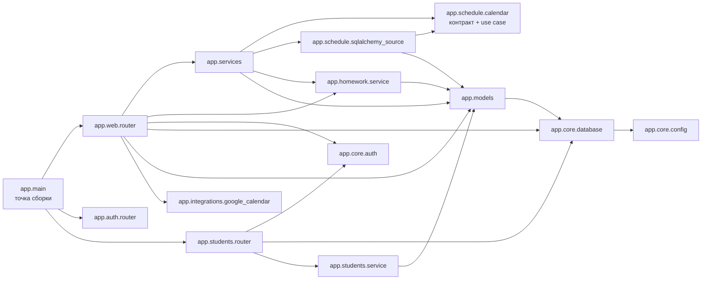

# Модульная карта TutorFlow — фактический срез

**Срез:** 19.10.2026, локальная ветка `feature/0104-pz02-artem`, точка ответвления — commit `3a3f23e2743b4798b9402fa3cc7c298c3a9d834c`; карта описывает изменения ПЗ №2 в локальном checkout.\
**Автор записей карты:** Артём (имя указано пользователем; фамилия не подтверждена). Это обозначает автора записей карты, а не авторство всего исходного кода.

Стрелка `A → B` означает зависимость исходного кода `A` от `B` (импорт/использование типов), а не направление вызова во время выполнения. Перечислены фактические зависимости ключевых backend-модулей; запланированные компоненты отделены от работающих.

## Реестр модулей

| Модуль / путь | Ответственность и публичный контракт | Фактические зависимости | Статус | Автор записи |
|---|---|---|---|---|
| `app.main` | Сборка приложения FastAPI и подключение маршрутизаторов | `app.web.router`, `app.auth.router`, `app.students.router`, конфигурация и шаблоны | работает | Артём |
| `app.web.router` | HTTP-маршруты кабинетов и API; проверка HTTP-входа, вызов сервисов, отображение результата | `app.services`, auth/database, модели, задания, интеграции и web-слой | работает | Артём |
| `app.services` | Прикладные операции и сериализаторы; `calendar_events(...)` — совместимая точка сборки источника расписания и адаптер прежней формы ответа | `app.schedule.*`, `app.models`, `app.homework.*` | работает | Артём |
| `app.schedule.calendar` | Контракт `CalendarEventSource`, нейтральные снимки и `CalendarEventService.list_events(...)`; не импортирует HTTP или SQLAlchemy | стандартная библиотека Python | работает | Артём |
| `app.schedule.sqlalchemy_source` | Read-only адаптер SQLAlchemy; читает уроки/сданные работы в сессии вызывающей стороны | `app.schedule.calendar`, `app.models`, SQLAlchemy | работает | Артём |
| `app.homework.service` | Сценарии заданий, получателей и сдач | схемы заданий, модели | работает | Артём |
| `app.students.service` | Прикладная логика карточки ученика и жизненного цикла связи | модели учеников и пользователя | работает | Артём |
| `app.auth.router` / `app.core.auth` | Вход, сессии, роли и защита маршрутов | `app.core`, `app.auth`, модели и сервис пользователя | работает | Артём |
| `app.models` / `app.core.database` | ORM-сущности, базовый metadata, сессия и подключение к БД | SQLAlchemy, конфигурация | работает | Артём |
| `app.integrations.google_calendar` | Граница-заглушка: состояние «не подключено», пустой список событий; настоящая синхронизация не реализована | стандартная библиотека Python | работает (только заглушка) | Артём |
| Интеграция OAuth и реальная синхронизация Google Calendar | Будущая внешняя интеграция; работающий протокол и хранение токенов отсутствуют | планируемый OAuth-клиент и внешняя сеть | план | Артём |
| Уведомления, Redis/Celery | Отложенные фоновые задачи и уведомления; код/очередь не подключены | планируемые инфраструктурные компоненты | план | Артём |

## Проверка направлений расписания

Для выделенного участка фактическая цепочка импортов: `app.web.router → app.services → app.schedule.calendar` и `app.services → app.schedule.sqlalchemy_source → app.schedule.calendar`; SQLAlchemy-адаптер также зависит от `app.models`. Ядро расписания не импортирует web-маршрут, `Session`, ORM-модель или шаблон. Конкретный источник выбирается в `app.services.calendar_events`, а `CalendarEventService` получает его через конструктор.

В существующем `app.services.calendar_events` сохранён адаптер старой формы ответа: URL, подписи, `title`, `subtitle`, `draggable` и вложенный словарь урока остаются на границе приложения. Продуктовая политика пересечений, влияние статуса `cancelled`, равенство границ и конкурентное бронирование этой картой не задаются.

**Основание карты:** импорты `app/main.py`, `app/web/router.py`, `app/services.py`, `app/schedule/calendar.py`, `app/schedule/sqlalchemy_source.py`, `app/models.py`, `app/core/database.py`, `app/homework/service.py` и `app/students/service.py`; схема сверена с исходным кодом на указанном локальном срезе. Общий архитектурный контекст: [`docs/architecture.md`](architecture.md).